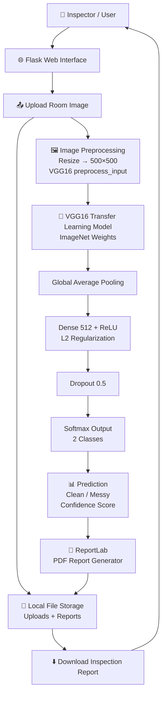
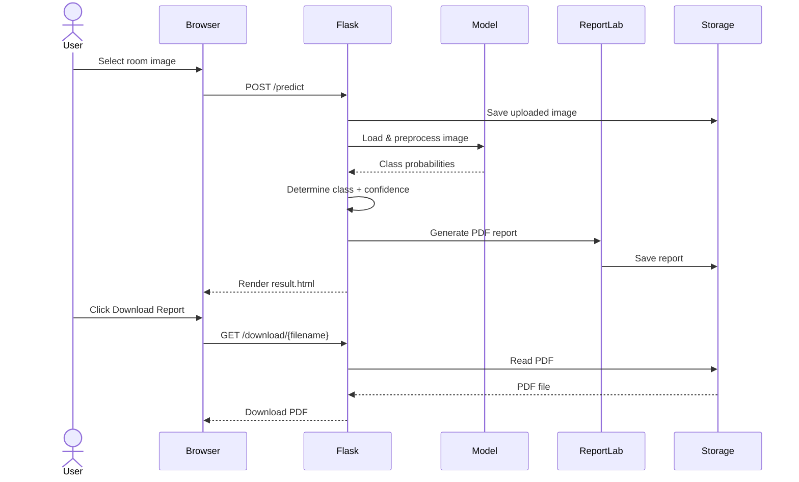
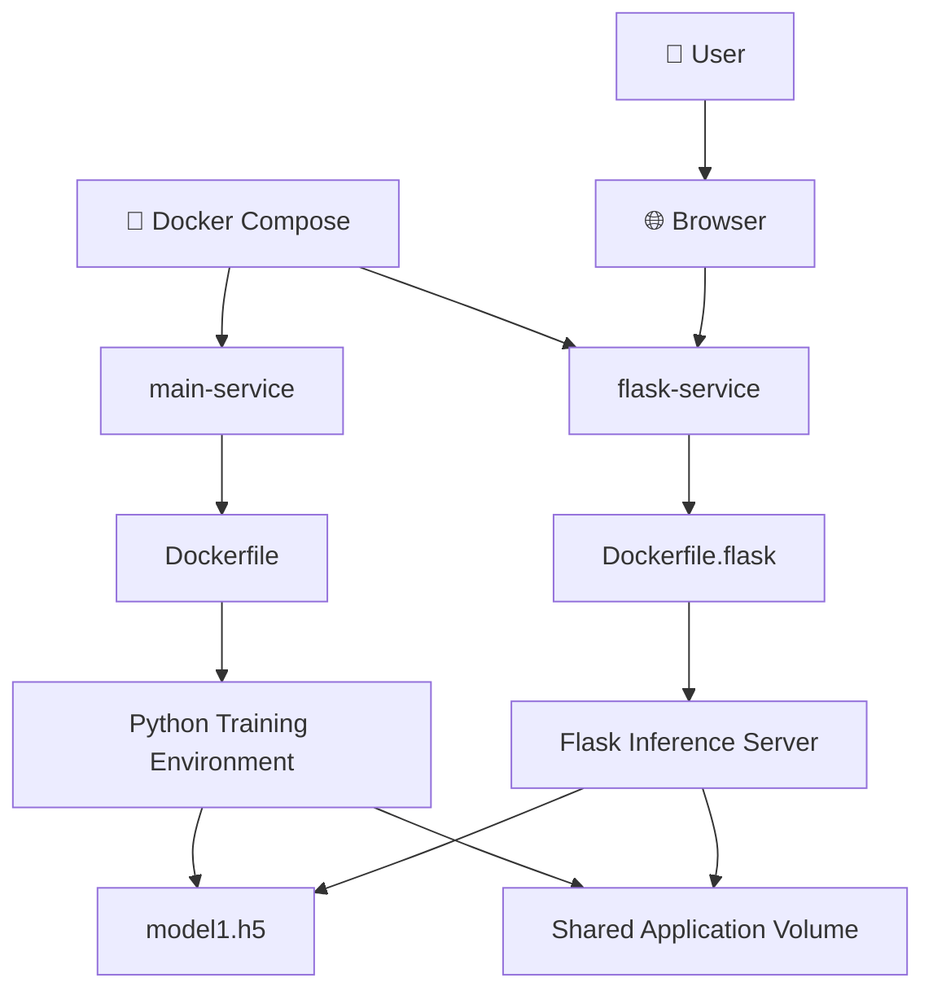

# 🏨 Automated Hotel Room Inspection & Report Generation

> **An AI-powered computer vision system that automatically evaluates hotel room cleanliness from images and generates a downloadable inspection report with classification confidence.**


---

## 📌 Project Overview

**Automated Hotel Room Inspection & Report Generation** is a computer vision application designed to automate the initial cleanliness inspection of hotel rooms.

Instead of requiring a staff member to manually inspect every uploaded room image, the system uses a **pre-trained VGG16-based deep learning model** to classify an image into:

* 🟢 **Clean**
* 🔴 **Messy**

The predicted class is accompanied by a **confidence score**, after which the system automatically generates a structured **PDF inspection report** containing the inspection information, classification result, confidence score, and inspected room image.

The project combines:

**Deep Learning + Transfer Learning + Computer Vision + Flask + Automated Reporting + Docker**

---

# 🎯 Problem Statement

Hotel room inspections are often repetitive and time-consuming.

A conventional workflow looks like:

```text
Room Cleaning
      ↓
Manual Inspection
      ↓
Inspector Reviews Room
      ↓
Records Result
      ↓
Creates Inspection Report
      ↓
Stores / Shares Report
```

This project introduces an automated first-level inspection workflow:

```text
Room Image
     ↓
AI-Based Image Classification
     ↓
Clean / Messy
     ↓
Confidence Score
     ↓
Automated PDF Report
```

This can help reduce repetitive manual effort and provide a consistent initial cleanliness assessment.

> **Important:** The system is intended as an automated classification/decision-support tool. It does not replace human inspection in situations requiring operational or safety judgment.

---

# ⭐ Key Features

### 🧠 AI-Based Cleanliness Classification

Uses a **VGG16 transfer-learning architecture** to classify hotel room images into two categories:

```text
                    Room Image
                        │
                        ▼
              ┌──────────────────┐
              │ Image Preprocess  │
              │ 500 × 500 × 3    │
              └────────┬─────────┘
                       │
                       ▼
              ┌──────────────────┐
              │      VGG16       │
              │ ImageNet Weights │
              └────────┬─────────┘
                       │
                       ▼
              ┌──────────────────┐
              │ Global Average   │
              │    Pooling       │
              └────────┬─────────┘
                       │
                       ▼
              ┌──────────────────┐
              │ Dense 512 ReLU   │
              │ + L2 Regularizer │
              └────────┬─────────┘
                       │
                       ▼
              ┌──────────────────┐
              │   Dropout 0.5    │
              └────────┬─────────┘
                       │
                       ▼
              ┌──────────────────┐
              │ Softmax (2 Class)│
              └────────┬─────────┘
                       │
              ┌────────┴────────┐
              ▼                 ▼
           Clean              Messy
```

---

# 📊 Confidence-Based Prediction

The model produces probabilities for both classes:

```text
Clean Probability = 0.93
Messy Probability = 0.07

              ↓

Prediction = Clean
Confidence = 93%
```

The application selects the class with the higher probability.

Conceptually:

```python
clean_prob, messy_prob = classes[0]

prediction = (
    "Clean"
    if clean_prob > messy_prob
    else "Messy"
)

confidence = max(clean_prob, messy_prob) * 100
```

---

# 📄 Automated PDF Report Generation

After classification, the system automatically creates a PDF inspection report.

The report contains:

* Inspection ID
* Date of inspection
* Property name
* Property region
* Property type
* Service
* Room/area inspected
* Inspection type
* Cleanliness status
* Confidence score
* Inspected room image

### Report Flow

```text
AI Prediction
      ↓
Inspection Metadata
      ↓
Report Data Object
      ↓
ReportLab PDF Generation
      ↓
PDF Report
      ↓
Download
```

Reports are generated under:

```text
static/reports/
```

---

# 🏗️ Complete System Architecture



---

# 🔬 Machine Learning Architecture

The classification model uses **transfer learning with VGG16**.

Instead of training a deep CNN completely from scratch, the project uses the feature-extraction capabilities of VGG16 pretrained on ImageNet.

### Architecture

```text
Input Image
500 × 500 × 3
      │
      ▼
┌─────────────────────┐
│       VGG16         │
│ ImageNet Weights    │
│ include_top=False   │
└──────────┬──────────┘
           │
           ▼
┌─────────────────────┐
│ GlobalAveragePooling│
│       2D            │
└──────────┬──────────┘
           │
           ▼
┌─────────────────────┐
│ Dense Layer         │
│ 512 neurons         │
│ ReLU activation     │
│ L2 regularization   │
└──────────┬──────────┘
           │
           ▼
┌─────────────────────┐
│ Dropout             │
│ 0.5                 │
└──────────┬──────────┘
           │
           ▼
┌─────────────────────┐
│ Dense Output        │
│ 2 neurons           │
│ Softmax             │
└──────────┬──────────┘
           │
       ┌───┴───┐
       ▼       ▼
     Clean   Messy
```

---

# 🧠 Why VGG16 Transfer Learning?

VGG16 already contains powerful visual feature representations learned from a large-scale image dataset.

Using transfer learning allows the project to:

* Reuse learned visual features
* Reduce training complexity
* Avoid training a deep CNN completely from scratch
* Adapt a proven architecture to the hotel-room cleanliness classification problem
* Build a practical binary image classification system

The convolutional base is initially frozen:

```python
base_model.trainable = False
```

The project then adds task-specific classification layers on top of VGG16.

---

# ⚙️ Model Configuration

The model is configured with:

| Component           | Configuration             |
| ------------------- | ------------------------- |
| Base Model          | VGG16                     |
| Pretrained Weights  | ImageNet                  |
| Input Size          | 500 × 500 × 3             |
| Include Top         | False                     |
| Feature Extraction  | Global Average Pooling 2D |
| Dense Layer         | 512 neurons               |
| Activation          | ReLU                      |
| Regularization      | L2                        |
| Dropout             | 0.5                       |
| Output Layer        | 2 neurons                 |
| Output Activation   | Softmax                   |
| Optimizer           | Adam                      |
| Learning Rate       | `0.00001`                 |
| Early Stopping      | Enabled                   |
| Patience            | 7 epochs                  |
| Training Epochs     | Up to 40                  |
| Training Batch Size | 64                        |

---

# 🧪 Training Pipeline

The model training workflow is implemented in:

```text
main.py
```

The pipeline includes:

```text
Dataset
   ↓
ImageDataGenerator
   ↓
Preprocessing
   ↓
Data Augmentation
   ↓
VGG16 Feature Extraction
   ↓
Classification Head
   ↓
Model Training
   ↓
Early Stopping
   ↓
Validation
   ↓
Model Evaluation
   ↓
Model Saved as .h5
```

---

# 🖼️ Image Preprocessing & Augmentation

The training pipeline uses TensorFlow/Keras `ImageDataGenerator`.

### Training preprocessing

The training pipeline uses VGG16's:

```python
preprocess_input
```

along with augmentation such as:

```text
Width Shift
Height Shift
Horizontal Flip
```

This helps expose the model to variations in room images.

### Validation preprocessing

Validation images are processed using the same VGG16 preprocessing function without the training augmentation transformations.

---

# 🧹 Binary Classification

The application performs two-class classification:

```text
              ┌──────────────┐
              │ Room Image   │
              └──────┬───────┘
                     │
                     ▼
             ┌───────────────┐
             │ Neural Network│
             └───────┬───────┘
                     │
             ┌───────┴────────┐
             ▼                ▼
         CLEAN             MESSY
```

The final softmax layer produces the class probabilities.

---

# 🖥️ Web Application Architecture

The inference application is implemented using **Flask**.

### Request Flow



---

# 🌐 Flask Routes

The application currently exposes the following main routes.

## `GET /`

Displays the room-cleanliness inspection interface.

```text
GET /
   ↓
index.html
   ↓
Upload Image
```

---

## `POST /predict`

The core inference endpoint.

```text
POST /predict
```

### Responsibilities

1. Receive uploaded image
2. Validate file presence
3. Save image
4. Preprocess image
5. Run model inference
6. Determine Clean/Messy classification
7. Calculate confidence
8. Generate inspection metadata
9. Generate PDF report
10. Render result page

---

## `GET /download/<filename>`

Downloads a generated report.

```text
GET /download/<path>
```

The endpoint uses Flask's `send_file()` functionality to return the generated file as a downloadable attachment.

---

# 🔄 End-to-End Application Flow

```text
                     USER
                      │
                      ▼
             ┌─────────────────┐
             │ Flask Web Page  │
             │   index.html    │
             └────────┬────────┘
                      │
                      ▼
             ┌─────────────────┐
             │ Select Image    │
             └────────┬────────┘
                      │
                      ▼
             ┌─────────────────┐
             │ POST /predict   │
             └────────┬────────┘
                      │
                      ▼
             ┌─────────────────┐
             │ Save Image      │
             │ static/uploads  │
             └────────┬────────┘
                      │
                      ▼
             ┌─────────────────┐
             │ Resize 500×500  │
             │ preprocess_input│
             └────────┬────────┘
                      │
                      ▼
             ┌─────────────────┐
             │ VGG16 Model     │
             └────────┬────────┘
                      │
                      ▼
             ┌─────────────────┐
             │ Clean / Messy   │
             │ + Confidence    │
             └────────┬────────┘
                      │
                      ▼
             ┌─────────────────┐
             │ Generate PDF    │
             │ with ReportLab  │
             └────────┬────────┘
                      │
                      ▼
             ┌─────────────────┐
             │ result.html     │
             │ Result + Link   │
             └────────┬────────┘
                      │
                      ▼
             ┌─────────────────┐
             │ Download Report │
             └─────────────────┘
```

---

# 📁 Project Structure

```text
Automated Inspection Report/
│
├── app.py
│
├── main.py
│
├── model1.h5
│
├── requirements.txt
│
├── Dockerfile
├── Dockerfile.flask
├── docker-compose.yml
├── .dockerignore
│
├── templates/
│   ├── index.html
│   └── result.html
│
└── static/
    │
    ├── uploads/
    │   ├── room-image-1.jpg
    │   ├── room-image-2.jpg
    │   └── ...
    │
    └── reports/
        ├── report.pdf
        ├── report_A273.pdf
        └── ...
```

---

# 📌 File Responsibilities

| File                 | Responsibility                                      |
| -------------------- | --------------------------------------------------- |
| `app.py`             | Flask inference application                         |
| `main.py`            | Model training and evaluation pipeline              |
| `model1.h5`          | Trained TensorFlow/Keras model                      |
| `index.html`         | Image upload interface                              |
| `result.html`        | Prediction result interface                         |
| `requirements.txt`   | Python dependencies                                 |
| `Dockerfile`         | Container configuration for training service        |
| `Dockerfile.flask`   | Container configuration for Flask inference service |
| `docker-compose.yml` | Multi-container orchestration                       |
| `static/uploads/`    | Uploaded inspection images                          |
| `static/reports/`    | Generated PDF reports                               |

---

# 🐳 Docker Architecture

The project includes Docker support with separate services for:

1. Model/training workflow
2. Flask inference application

### Docker Compose Architecture



---

# 🐳 Docker Services

## `main-service`

Configured through:

```text
Dockerfile
```

Runs:

```bash
python main.py
```

This service is associated with the model training pipeline.

---

## `flask-service`

Configured through:

```text
Dockerfile.flask
```

Runs:

```bash
python app.py
```

and exposes:

```text
5000:5000
```

This is the web-based inference service.

---

# 🚀 Installation

## Prerequisites

Install:

* Python 3.9+
* pip
* Git
* Docker Desktop *(optional)*
* Docker Compose *(optional)*

---

# 1️⃣ Clone the Repository

```bash
git clone <https://github.com/patilsharvari184/Automated-Hotel-Room-Inspection-Report-Generation>
cd "Automated Inspection Report"
```

---

# 2️⃣ Create Virtual Environment

```bash
python -m venv venv
```

### Windows

```bash
venv\Scripts\activate
```

### Linux / macOS

```bash
source venv/bin/activate
```

---

# 3️⃣ Install Dependencies

```bash
pip install -r requirements.txt
```

---

# 4️⃣ Verify Model File

Make sure the trained model is available in the project root:

```text
model1.h5
```

The Flask application loads:

```python
MODEL_PATH = 'model1.h5'
```

---

# 5️⃣ Run the Flask Application

```bash
python app.py
```

The application runs on:

```text
http://localhost:5000
```

Open the URL in your browser.

---

# 🖥️ Using the Application

### Step 1 — Open the application

Navigate to:

```text
http://localhost:5000
```

### Step 2 — Upload a room image

Select a hotel room image.

### Step 3 — Start inspection

Click:

```text
🚀 Inspect Image
```

### Step 4 — AI classification

The model analyzes the image.

Possible results:

```text
Clean
```

or:

```text
Messy
```

### Step 5 — View confidence

The result page displays:

```text
Cleanliness Status: Clean
Confidence: XX.XX%
```

### Step 6 — Generate report

A PDF inspection report is automatically created.

### Step 7 — Download

Click:

```text
Download Report
```

to download the generated inspection report.

---

# 🐳 Run with Docker Compose

Build and start the services:

```bash
docker compose up --build
```

The Flask application is exposed on:

```text
http://localhost:5000
```

To stop:

```bash
docker compose down
```

---

# 🧪 Model Training

Model training is implemented in:

```text
main.py
```

The expected training directory structure is:

```text
hotel_dataset/
│
└── Dataset/
    │
    ├── train/
    │   ├── Clean/
    │   └── Messy/
    │
    └── val/
        ├── Clean/
        └── Messy/
```

The training script uses:

```python
flow_from_directory()
```

to load the dataset.

> **Important:** The current `main.py` contains local Windows dataset paths such as `E:/Benchmark/...`. These should be changed to your local dataset paths before retraining.

---

# 🧠 Training Configuration

The model training pipeline uses:

```text
Image Size       → 500 × 500
Color Mode       → RGB
Training Batch   → 32 in generator
Training Epochs  → 40 maximum
Optimizer        → Adam
Learning Rate    → 1e-5
Early Stopping   → patience = 7
Base Network     → VGG16
Weights          → ImageNet
```

The training generator also applies:

```text
Width Shift
Height Shift
Horizontal Flip
```

---

# 📉 Training Monitoring

The training script tracks:

```text
Training Accuracy
Validation Accuracy
Training Loss
Validation Loss
```

and plots the corresponding curves.

This helps identify:

* Overfitting
* Underfitting
* Training instability
* Validation performance
* Generalization behavior

---

# 🛑 Early Stopping

The training pipeline uses:

```python
EarlyStopping(
    monitor='val_loss',
    patience=7,
    restore_best_weights=True
)
```

This prevents unnecessary training when validation performance stops improving and restores the best-performing weights.

---

# 💾 Model Persistence

After training, the model can be saved in HDF5 format:

```text
.h5
```

The deployed Flask application loads the trained model using:

```python
load_model(MODEL_PATH, compile=False)
```

This allows inference without retraining the network.

---

# 📄 PDF Report Architecture

The PDF generation functionality is implemented using **ReportLab**.

```text
                    Inspection Result
                           │
                           ▼
                  ┌──────────────────┐
                  │ Inspection Data  │
                  └────────┬─────────┘
                           │
        ┌──────────────────┼───────────────────┐
        │                  │                   │
        ▼                  ▼                   ▼
 Inspection ID          Date             Property Data
        │                  │                   │
        └──────────────────┼───────────────────┘
                           ▼
                 Cleanliness Classification
                           │
                           ▼
                    Confidence Score
                           │
                           ▼
                     Room Image
                           │
                           ▼
                  ┌──────────────────┐
                  │    ReportLab     │
                  └────────┬─────────┘
                           │
                           ▼
                    Inspection PDF
```

---

# 📋 Example Report Data

The current application creates inspection metadata such as:

```text
Inspection ID: A273
Date of Inspection: DD/MM/YYYY
Property Name: Sample Hotel
Property Region: Urban
Property Type: Hotel
Service: Room Cleaning
Room/Area Inspected: Room 302
Inspection Type: Routine

Overall Cleanliness Status: Clean
Confidence Score: 94.XX%
```

The room image is also embedded into the PDF.

> The current implementation uses sample/static property metadata. In a production system, these fields could be collected dynamically from the inspector or integrated with a hotel/property management system.

---

# 🛠️ Technology Stack

## Machine Learning

* Python
* TensorFlow
* Keras
* VGG16
* Transfer Learning
* ImageNet pretrained weights
* NumPy
* OpenCV
* Pillow

## Computer Vision

* Image preprocessing
* Image resizing
* Data augmentation
* CNN-based classification
* VGG16 feature extraction

## Backend

* Flask
* Python
* Jinja2 templates
* File upload handling

## Reporting

* ReportLab
* PDF generation
* Embedded inspection images

## Data Science

* Pandas
* NumPy
* Matplotlib
* Seaborn

## Deployment

* Docker
* Docker Compose

---

# 🔐 Current Security Considerations

The current application is primarily a prototype/demo implementation.

For production deployment, the following should be added:

* File type validation
* File size limits
* Secure filename handling
* Authentication and authorization
* HTTPS
* CSRF protection
* Rate limiting
* Secure upload directories
* Input sanitization
* Production WSGI server
* Proper error handling
* Logging and monitoring

### File Upload Security

The current implementation saves files using the uploaded filename:

```python
filepath = os.path.join(
    'static/uploads',
    file.filename
)
```

For production, this should be hardened using mechanisms such as:

```python
secure_filename()
```

and stricter file validation.

---

# ⚡ Performance Considerations

The current system loads the trained model when the Flask application starts:

```python
model = load_model(MODEL_PATH, compile=False)
```

This is preferable to loading the model for every request because model initialization is computationally expensive.

The inference flow then becomes:

```text
Application Startup
       ↓
Load Model Once
       ↓
Keep Model in Memory
       ↓
Multiple Predictions
```

---

# 🧠 Important Engineering Decisions

## 1. Transfer Learning

Rather than designing and training a CNN from scratch, the project uses VGG16 pretrained on ImageNet.

**Benefit:**

```text
Pretrained Visual Features
          ↓
Task-Specific Classification Head
          ↓
Hotel Room Cleanliness Classifier
```

---

## 2. Global Average Pooling

Instead of directly flattening the convolutional feature map, the project uses:

```python
GlobalAveragePooling2D()
```

This reduces the dimensionality of extracted features before the dense classification layer.

---

## 3. Dropout

The classification head uses:

```python
Dropout(0.5)
```

to reduce the risk of overfitting.

---

## 4. L2 Regularization

The dense layer uses L2 regularization:

```python
regularizers.l2(0.01)
```

This adds another mechanism to control model complexity.

---

## 5. Early Stopping

The model monitors validation loss and restores the best weights, helping avoid unnecessary over-training.

---

# 📈 Potential Production Architecture

The current project is a strong prototype. A production-grade version could evolve into:

```text
                       ┌───────────────┐
                       │    Inspector  │
                       └───────┬───────┘
                               │
                               ▼
                     ┌──────────────────┐
                     │ Web / Mobile App │
                     └────────┬─────────┘
                              │
                              ▼
                     ┌──────────────────┐
                     │ API Gateway      │
                     └────────┬─────────┘
                              │
                              ▼
                     ┌──────────────────┐
                     │ Flask/FastAPI    │
                     │ Backend          │
                     └────────┬─────────┘
                              │
                ┌─────────────┼──────────────┐
                │             │              │
                ▼             ▼              ▼
          Image Storage    ML Service    Report Service
                │             │              │
                │             ▼              ▼
                │         VGG16 Model      PDF
                │             │
                └─────────────┼──────────────┘
                              ▼
                       Database / Storage
```

Potential additions:

* REST API
* Database for inspection history
* Cloud object storage
* Authentication
* Dashboard
* Batch inspection
* Multiple room categories
* Async inference
* Model monitoring
* Cloud deployment
* CI/CD

---

# 🔮 Future Enhancements

## 🤖 AI/ML

* Fine-tune the final VGG16 layers
* Compare VGG16 against ResNet/EfficientNet
* Add more cleanliness categories
* Detect specific issues instead of only Clean/Messy
* Object detection for beds, bathrooms, furniture, etc.
* Segmentation of problematic areas
* Explainable AI / Grad-CAM visualizations
* Confidence thresholding
* Model versioning

---

## 🏨 Hotel Operations

Future versions could classify:

```text
Room
 ├── Clean
 ├── Messy
 ├── Bed Not Made
 ├── Bathroom Issue
 ├── Waste Detected
 ├── Linen Issue
 └── Maintenance Issue
```

This could transform the application from a binary classifier into a broader **hotel room inspection platform**.

---

## 📊 Inspection Dashboard

A future dashboard could provide:

```text
Total Inspections
       │
       ├── Clean Rooms
       ├── Messy Rooms
       ├── Average Confidence
       ├── Daily Inspections
       └── Room-wise Issues
```

---

## ☁️ Deployment

Potential deployment targets include:

* AWS
* Azure
* Google Cloud
* Docker-based VM deployment
* Kubernetes

---

# 🚧 Current Limitations

The current implementation has several prototype-level limitations:

### Dataset Path

The training script currently contains machine-specific dataset paths.

These should be replaced with configurable paths or environment variables.

### Static Property Information

The generated report currently uses values such as:

```text
Sample Hotel
Urban
Hotel
Room 302
Routine
```

These can be converted into dynamic user inputs.

### Binary Classification

The current model only predicts:

```text
Clean
Messy
```

It does not identify the exact reason a room is classified as messy.

### Local Storage

Uploaded images and generated reports are stored locally.

A production deployment would benefit from object storage.

### No Authentication

The current Flask application does not implement user authentication.

### Development Server

The application currently uses Flask's development server:

```python
app.run(
    host="0.0.0.0",
    port=5000,
    debug=True
)
```

A production deployment should use an appropriate production WSGI server and disable debug mode.

---

# 🧪 Example Use Case

### Scenario

A hotel inspector finishes cleaning Room 302 and captures a photo.

Instead of manually documenting the inspection:

```text
Take Image
    ↓
Upload
    ↓
AI Analysis
    ↓
Clean
    ↓
94.72% Confidence
    ↓
PDF Report
    ↓
Download / Store
```

The system provides an automated first-level cleanliness assessment.

---

# 💼 Business Value

This project demonstrates how computer vision can be applied to an operational workflow rather than being limited to a standalone ML experiment.

### Potential benefits

* ⏱️ Reduce repetitive inspection effort
* 📋 Standardize initial inspection decisions
* 📄 Automate report generation
* 📊 Create consistent inspection records
* 🤖 Introduce AI-assisted quality control
* 🏨 Support hotel housekeeping workflows
* 📈 Provide a foundation for future inspection analytics

---

# 🧠 Technical Skills Demonstrated

This project demonstrates practical experience in:

```text
Python
TensorFlow
Keras
Deep Learning
CNN
VGG16
Transfer Learning
Computer Vision
Image Classification
Image Preprocessing
Data Augmentation
Model Evaluation
Early Stopping
Regularization
Flask
Jinja2
REST-style Web Workflow
File Upload Handling
PDF Generation
ReportLab
Docker
Docker Compose
Linux/Container Concepts
```

---

# 📌 Resume-Ready Project Description

### Short Version

> **Automated Hotel Room Inspection Report Generator** — Developed a Flask-based computer vision application using a VGG16 transfer-learning model to classify hotel room images as Clean or Messy with confidence scoring, and automatically generate downloadable PDF inspection reports containing classification results and room images. Containerized the training and inference workflow using Docker Compose.

### Technical Version

> Built an end-to-end AI-powered hotel room inspection system using TensorFlow/Keras and VGG16 transfer learning. Implemented 500×500 image preprocessing, ImageNet-based feature extraction, Global Average Pooling, regularized dense classification, dropout, early stopping, and softmax-based Clean/Messy prediction. Integrated Flask for image upload and inference, ReportLab for automated PDF report generation, and Docker Compose for containerized training/inference services.

---

# 🎤 Interview Explanation

If asked **"Explain your project"**, you can explain it like this:

> "I developed an automated hotel room inspection system using computer vision. The objective was to automate the initial cleanliness assessment of hotel rooms from images. I used VGG16 with ImageNet pretrained weights as the feature extractor and added a custom classification head consisting of Global Average Pooling, a 512-neuron dense layer with ReLU and L2 regularization, dropout, and a two-class softmax output for Clean and Messy.
>
> For training, I used Keras ImageDataGenerator with VGG16 preprocessing and augmentation such as width shifting, height shifting, and horizontal flipping. I also implemented early stopping based on validation loss.
>
> After training, I integrated the saved model into a Flask application. The user uploads a room image, the application preprocesses it to 500×500, performs inference, calculates the confidence score, and generates a PDF inspection report using ReportLab. The report contains inspection metadata, the classification result, confidence, and the original room image. I also containerized the training and Flask inference components using Docker Compose."

---

# 🏆 Why This Project Stands Out

This project combines multiple engineering layers instead of being only a machine learning notebook:

```text
                    AI PROJECT
                        │
        ┌───────────────┼────────────────┐
        │               │                │
        ▼               ▼                ▼
   ML MODEL         WEB APP          REPORTING
        │               │                │
     VGG16            Flask          ReportLab
        │               │                │
 Transfer Learning   Uploads          PDF
        │               │                │
        └───────────────┼────────────────┘
                        │
                        ▼
                    DOCKER
                        │
                        ▼
                DEPLOYABLE SYSTEM
```

The project therefore demonstrates:

**Model Development → Model Integration → Application Development → Automated Reporting → Containerization**

---

# 📊 Architecture Summary

| Layer            | Technology       | Responsibility                |
| ---------------- | ---------------- | ----------------------------- |
| User Interface   | HTML/CSS         | Image upload + result display |
| Web Layer        | Flask            | Request handling and routing  |
| ML Layer         | TensorFlow/Keras | Image classification          |
| CNN Backbone     | VGG16            | Visual feature extraction     |
| Classification   | Dense + Softmax  | Clean/Messy prediction        |
| Preprocessing    | Keras + Pillow   | Image preparation             |
| Computer Vision  | OpenCV/Pillow    | Image processing              |
| Reporting        | ReportLab        | PDF generation                |
| Storage          | Local filesystem | Images + reports              |
| Containerization | Docker           | Environment isolation         |
| Orchestration    | Docker Compose   | Multi-service execution       |

---

# 🔗 Project Flow at a Glance

```text
             ┌─────────────────────────┐
             │       ROOM IMAGE        │
             └────────────┬────────────┘
                          │
                          ▼
             ┌─────────────────────────┐
             │     FLASK APPLICATION   │
             └────────────┬────────────┘
                          │
                          ▼
             ┌─────────────────────────┐
             │ IMAGE PREPROCESSING     │
             │ 500 × 500 + VGG16 Prep  │
             └────────────┬────────────┘
                          │
                          ▼
             ┌─────────────────────────┐
             │       VGG16 CNN         │
             │   ImageNet Features     │
             └────────────┬────────────┘
                          │
                          ▼
             ┌─────────────────────────┐
             │ CUSTOM CLASSIFICATION   │
             │ GAP → Dense → Dropout   │
             └────────────┬────────────┘
                          │
                          ▼
                  ┌───────┴────────┐
                  │                │
                  ▼                ▼
               CLEAN             MESSY
                  │                │
                  └───────┬────────┘
                          │
                          ▼
             ┌─────────────────────────┐
             │    CONFIDENCE SCORE     │
             └────────────┬────────────┘
                          │
                          ▼
             ┌─────────────────────────┐
             │     REPORTLAB PDF       │
             │     REPORT GENERATOR    │
             └────────────┬────────────┘
                          │
                          ▼
             ┌─────────────────────────┐
             │   DOWNLOAD INSPECTION   │
             │         REPORT          │
             └─────────────────────────┘
```

---

# 👨‍💻 Author

## Sharvari Patil

**AI/ML Engineer | Python Developer | Generative AI Enthusiast**

Interested in building practical AI systems involving:

* Artificial Intelligence
* Machine Learning
* Computer Vision
* Deep Learning
* Generative AI
* Python
* FastAPI / Flask
* AI-powered automation

---

# ⭐ Project Highlights

> **From image → AI prediction → confidence score → automated PDF inspection report.**

This project demonstrates the complete journey of taking a trained deep learning model and turning it into a usable application.

### Core Pipeline

```text
📷 Image
   ↓
🧠 VGG16
   ↓
🔍 Feature Extraction
   ↓
⚡ Classification
   ↓
📊 Confidence
   ↓
📄 PDF Report
   ↓
⬇️ Download
```

---

## 🚀 Future Vision

The long-term vision is to evolve this prototype into an intelligent **Hotel Quality Inspection Platform** capable of:

```text
                 HOTEL INSPECTION AI
                         │
        ┌────────────────┼────────────────┐
        ▼                ▼                ▼
   Cleanliness       Maintenance       Safety
    Detection         Detection        Detection
        │                │                │
        └────────────────┼────────────────┘
                         ▼
                  AI Inspection
                     Dashboard
                         │
                         ▼
                 Automated Reports
                         │
                         ▼
                  Hotel Operations
```

The current Clean/Messy classifier provides the foundation for that larger system.

---

## ⭐ If you find this project useful

Feel free to explore the implementation, experiment with the model, improve the classification pipeline, or extend it into a production-ready hotel inspection platform.
